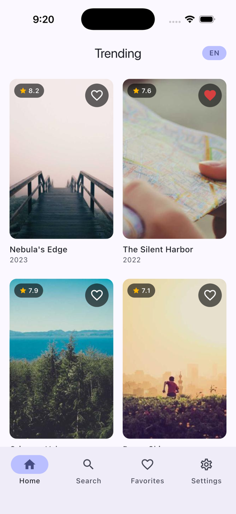
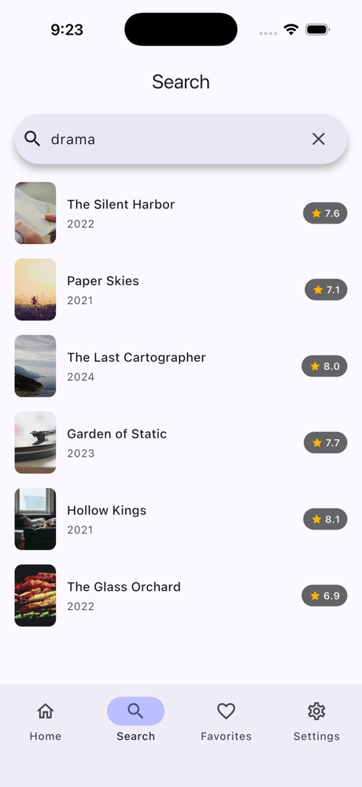
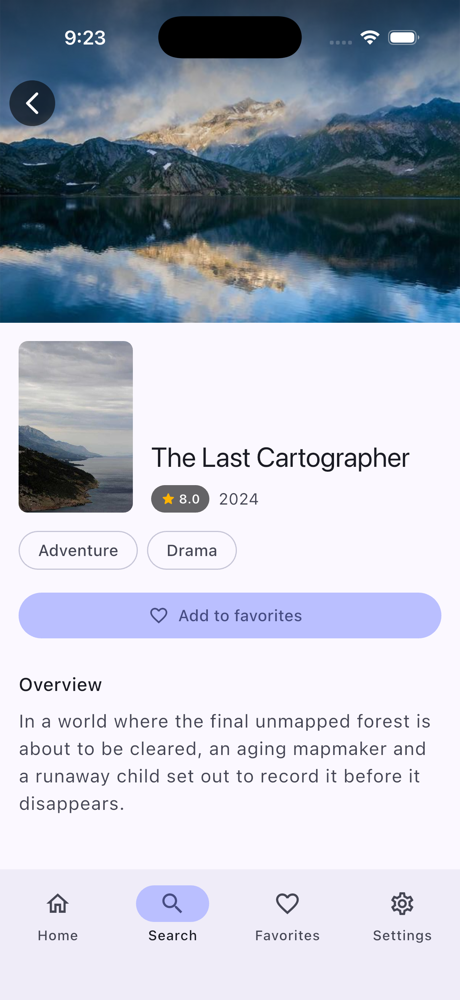
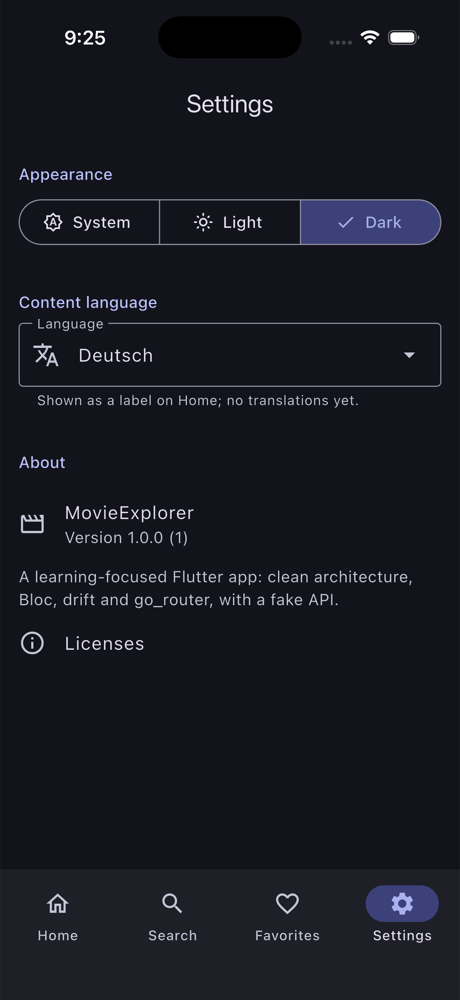

# 🎬 MovieExplorer (Flutter)

[](https://github.com/MuhammadFaheemAkram/MovieExplorer-Flutter/actions/workflows/flutter-ci.yml)


A learning-focused, production-inspired **Flutter** app built with **Flutter 3.47**, **Dart 3.13** and a clean, layered architecture. MovieExplorer lets you browse trending movies, search, view details, save favorites offline and pick a theme. Everything is backed by a **fake network layer**, so it runs with **no API key and no backend**. Only the poster images need a connection.

> **Why this repo exists**
>
> It is the Flutter edition of an app that also exists natively for [Android](https://github.com/MuhammadFaheemAkram/MovieExplorer) and [iOS](https://github.com/MuhammadFaheemAkram/iMovieExplorer).
>
> It is a compact but realistic reference for modern Flutter engineering:
> - Cubit/Bloc state management, including Bloc event transformers;
> - the repository pattern;
> - code-generated DI with `get_it` + `injectable`;
> - a drift database and `shared_preferences`;
> - typed `go_router` navigation;
> - a real test suite (159 tests) and CI.
>
> It does all this without being over-engineered. Each phase ships with a beginner-to-intermediate friendly write-up in [`docs/`](docs/) that also shows how the Android and iOS editions solved the same problem.

---

## 📋 Project Status

MovieExplorer was built in **strict, reviewable phases**. Each phase ended with a building app (Android + iOS), a clean analyzer, passing tests, a summary doc and exactly one commit. **All four phases are complete.**

| Phase | Scope | Status |
|------:|-------|:------:|
| 1 | Foundation: FVM project, design system base, typed navigation (4-tab shell), DI root | ✅ Done |
| 2 | Models + fake API + repository + Home (trending) | ✅ Done |
| 3 | drift favorites + movie details | ✅ Done |
| 4 | Search + settings + tests + polish | ✅ Done |

---

## ✨ Features

- 🔥 Browse **trending movies** in a poster grid, with pull-to-refresh
- 🔎 **Search** by title or genre: debounced, and a newer query cancels the one in flight
- 🎞️ Open **movie details**, pushed inside whichever tab you are in, with a `Hero` poster
- ❤️ **Favorites** stored with drift; one live stream drives every heart in the app
- 📴 Favorites and their details work **fully offline**
- ⚙️ **Settings**: appearance (System / Light / Dark, app-wide and persisted) and content language (shown as a badge on Home)
- 🧭 Four tabs, each with **its own back stack**
- ✅ Explicit **loading / empty / error** states everywhere

---

## 📸 Screenshots

| Home | Search | Details | Settings (dark) |
|:---:|:---:|:---:|:---:|
|  |  |  |  |

More (including dark Home and Favorites) in [docs/SCREENSHOTS.md](docs/SCREENSHOTS.md).

---

## 🧰 Tech Stack

| Area | Choice | Why | Since |
|------|--------|-----|:-----:|
| Toolchain | Flutter 3.47.6 · Dart 3.13, pinned with [FVM](https://fvm.app) (`.fvmrc`) | reproducible builds; other projects keep their own version | 1 |
| Platforms | Android · iOS 15+ | | 1 |
| UI | [`material_ui`](https://pub.dev/packages/material_ui) | Material 3 as a standalone package (new in Flutter 3.47) | 1 |
| Navigation | `go_router` + `go_router_builder` | typed routes; `StatefulShellRoute` gives each tab its own stack | 1 |
| Dependency injection | `get_it` + `injectable` | a code-generated composition root; async singletons resolved before `runApp` | 1 |
| State management | `flutter_bloc` | Cubits for plain intents, a Bloc where events need transformers | 2 |
| Event transformers | `bloc_concurrency` + `stream_transform` | debounce + `restartable` for Search, `droppable` for retry | 4 |
| Models | `freezed` + `json_serializable` | value equality, sealed state unions, checked JSON decoding | 2 |
| Images | `cached_network_image` | disk + memory caching, placeholders | 2 |
| Database | `drift` (SQLite) | typed SQL, reactive `watch()` queries, transactions | 3 |
| Preferences | `shared_preferences` (`SharedPreferencesWithCache`) | synchronous reads after init, so the saved theme applies on the first frame | 4 |
| App info | `package_info_plus` | the version shown in Settings → About | 4 |
| Testing | `flutter_test`, `bloc_test`, `mocktail` | fakes for data, mocks for widget tests | 1+ |
| Lints / CI | `flutter_lints` + strict analyzer modes; GitHub Actions | codegen, format, analyze and test on every push | 1, 4 |

---

## 🏛️ Architecture

A clean, layered architecture with a one-directional data flow. The full write-up is in [docs/ARCHITECTURE.md](docs/ARCHITECTURE.md).

```
lib/
├── app/        → root widget (MaterialApp.router, themeMode from SettingsCubit)
├── core/       → design system, navigation, network, database, storage, common
├── data/       → repository implementations + mappers
├── domain/     → entities, repository contracts, use cases (pure Dart)
├── features/   → one folder per screen (Page + View + Cubit/Bloc)
└── di/         → composition root (get_it + injectable)
```

**Data flow:**

```
View ──intent──▶ Cubit / Bloc ──▶ UseCase ──▶ MovieRepository ────▶ FakeMovieApiService (bundled JSON)
 ▲                    │                              └────────────▶ drift (favorites)
 │                    │                ──▶ SettingsRepository ──▶ SharedPreferencesWithCache
 └────── state ◀──────┘◀──────────── Result / Stream ◀──────────────┘
```

**Navigation:**

```
GoRouter ──▶ StatefulShellRoute ── AppShell (Scaffold + NavigationBar)
               ├─ Home branch       /home        ──▶ /home/movie/:id
               ├─ Search branch     /search      ──▶ /search/movie/:id
               ├─ Favorites branch  /favorites   ──▶ /favorites/movie/:id
               └─ Settings branch   /settings
```

Key rules:
- **Widgets render state; logic lives elsewhere.** Each screen is a Page (provides its Cubit/Bloc) plus a View (renders state, forwards intents).
- **Cubit by default, Bloc when events add value.** Search is the one Bloc: it needs debounce and cancellation.
- **Typed routes only.** No string paths in widgets.
- **Single source of truth.** Favorites are observed from drift streams; settings from the repository's stream.
- **Layer boundaries.** `domain/` is pure Dart (no Flutter, no drift, no JSON), and drift files never import `material_ui`.

---

## 🗂️ Folder Structure

```
MovieExplorer/
├── .fvmrc                              # pinned Flutter version (3.47.6)
├── .github/                            # CI workflow, issue and PR templates
├── analysis_options.yaml               # lints + strict analyzer modes
├── build.yaml                          # drift DateTime option; lint-free generated files
├── assets/json/trending_movies.json    # fake-API catalog (same file as the iOS edition)
├── docs/                               # architecture, testing, learning notes, phase summaries, screenshots
├── lib/
│   ├── main.dart                       # binding → await configureDependencies() → runApp
│   ├── app/                            # MovieExplorerApp, AppThemeMode → ThemeMode mapper
│   ├── core/
│   │   ├── common/                     # Result, AppException, AppConfig
│   │   ├── design_system/              # theme/ (AppTheme, AppColors, tokens) + widgets/
│   │   ├── navigation/                 # app_routes.dart (+ .g.dart), app_router.dart, app_shell.dart
│   │   ├── network/                    # MovieApiService, FakeMovieApiService, AssetJsonLoader, dto/
│   │   ├── database/                   # AppDatabase, FavoriteMovies table, FavoritesDao, converters/
│   │   └── storage/                    # SettingsLocalDataSource (SharedPreferencesWithCache)
│   ├── data/
│   │   ├── mapper/                     # MovieDto → Movie, FavoriteMovieRow ↔ Movie
│   │   └── repository/                 # MovieRepositoryImpl, SettingsRepositoryImpl
│   ├── domain/
│   │   ├── model/                      # Movie, AppSettings, AppThemeMode, ContentLanguage, favorite overlay
│   │   ├── repository/                 # MovieRepository, SettingsRepository (contracts)
│   │   └── usecase/                    # movies, favorites and settings use cases
│   ├── features/
│   │   ├── home/                       # page, view, cubit/
│   │   ├── search/                     # page, view, bloc/ (events, states, transformers)
│   │   ├── favorites/                  # page, view, cubit/
│   │   ├── details/                    # page, view, cubit/
│   │   └── settings/                   # page, view, cubit/ (app-scoped)
│   └── di/                             # injection.dart (+ .config.dart), app_module.dart
└── test/                               # mirrors lib/, plus helpers/ (fixtures, fakes, pump helpers)
```

---

## ▶️ How to Run

Prerequisites:
- [FVM](https://fvm.app);
- Xcode, for iOS;
- the Android SDK, with Java 17+ (Android Studio's bundled JDK works).

```bash
fvm install            # installs the version pinned in .fvmrc (3.47.6)
fvm flutter pub get
fvm flutter run        # pick an Android emulator or an iOS simulator
```

Generated code (`*.g.dart`, `*.freezed.dart`, `*.config.dart`) is committed, so the app runs straight after cloning. After changing annotated code, regenerate it:

```bash
fvm dart run build_runner build   # or: watch
```

---

## 🌐 How the Fake API Works

There is no backend. `FakeMovieApiService` implements the same `MovieApiService` contract a real client would:

- It reads [`assets/json/trending_movies.json`](assets/json/trending_movies.json), the same 12-movie catalog the iOS edition bundles, through `AssetJsonLoader`.
- It decodes the catalog into `MovieDto`s with `json_serializable`. The snake_case keys map automatically, and a malformed catalog becomes a `DataFormatException`.
- It simulates latency: 800 ms for trending, 400 ms for search and 500 ms for details.
- Search matches the **title or a genre**, case-insensitively. An unknown id throws `NotFoundException`.
- Setting `AppConfig.simulateNetworkErrors = true` makes every call throw `NetworkException`, so you can walk through each screen's error state.

`MovieRepositoryImpl` maps the DTOs to domain `Movie`s and turns exceptions into `Result` values (`Ok` / `Err`), so nothing above the data layer needs `try`/`catch`. Swapping in a real `dio` client means writing another `MovieApiService` and changing one DI annotation.

---

## 💾 How Local Persistence Works

### Favorites: drift

Favorites live in a [drift](https://drift.simonbinder.eu) SQLite database, which is **the single source of truth** for what is favorited.

- **Storage**
  - The `FavoriteMovies` table stores the *whole* movie, so Favorites and Details work fully offline.
  - Genres go through a JSON `TypeConverter`.
  - `addedAt` is stored as UTC ISO-8601 text (see `build.yaml`), so "newest first" is exact.
- **`FavoritesDao`** exposes `watchAll()` and `watchIds()`. These are drift `watch()` queries: they re-emit whenever the table changes. Its `toggle()` runs inside a transaction.
- **Hearts**
  - Screens never store favorite flags. Home and Details overlay `isFavorite` from the one `watchFavoriteIds()` stream.
  - So a heart tapped on Home, in Details or in Favorites updates everywhere at once.
- **Removing from Favorites** is optimistic: the row disappears immediately and the store confirms it. A swiped `Dismissible` must never be rebuilt into the list, and the update is rolled back if the write fails.
- **Details offline:** if the API fails but the movie is a favorite, the stored copy is shown.

### Settings: SharedPreferencesWithCache

- `SharedPreferencesWithCache` is created **before `runApp`** (an injectable `@preResolve` singleton), with an allow-list of the two keys. After that, reads are synchronous.
- `SettingsRepositoryImpl` keeps the current `AppSettings` and publishes every change on a stream.
- `SettingsCubit` lives **above `MaterialApp.router`**. Its initial state is read synchronously, so a saved Dark theme is applied on the very first frame, with no light flash.
- Values are stored by enum *name* (`dark`, `de`), and unknown values fall back to the defaults.

> **drift ↔ Room ↔ SwiftData, and prefs ↔ DataStore ↔ UserDefaults.**
> - drift's table class, DAO and `watch()` stream map to Room's `@Entity`, `@Dao` and `Flow` on Android, and to SwiftData's `@Model` plus an observing store on iOS.
> - `SharedPreferencesWithCache` plays the role of Jetpack DataStore (Preferences) on Android and a `UserDefaults`-backed store on iOS.

---

## 🔎 How Search Works

`SearchBloc` is the app's one event-driven Bloc, because typing needs **event transformers**:

```
keystroke ─▶ SearchQueryChanged ─▶ debounceRestartable(300 ms) ─▶ _onQueryChanged ─▶ SearchMoviesUseCase
                                     │ blank? → passes at once (idle)
                                     │ newer event? → the timer restarts; an in-flight search is cancelled
retry ─────▶ SearchRetried ──────▶ droppable() (extra taps while searching are ignored)
```

- A **blank** query goes idle immediately and drops any pending search.
- `restartable()` **cancels** the previous handler, so a slow, older search can never overwrite a newer one.
- The query already on screen is not searched again. A query whose search was cancelled mid-flight *is*. (A regression test covers this; see [Phase 4](docs/PHASE_4_SUMMARY.md).)

---

## ✅ Testing

```bash
fvm flutter analyze
fvm dart format --output=none --set-exit-if-changed .
fvm flutter test
```

**159 tests** across drift (in-memory SQLite), repositories, the fake API, use cases, every Cubit and the Bloc (`bloc_test`), every view (widget tests with `MockCubit` / `MockBloc`), the design system, and app-level flows (tabs, per-tab back stacks, Search end to end, favorites in sync across tabs, the theme switching app-wide).

The per-area breakdown and the testing techniques are in [docs/TESTING.md](docs/TESTING.md).

**CI:** [`.github/workflows/flutter-ci.yml`](.github/workflows/flutter-ci.yml) runs on every push to `main` and every pull request. It installs the FVM-pinned Flutter, checks that the committed generated code is up to date, then runs format, analyze and test.

---

## 📱 Same App on Other Platforms

| Edition | Stack | Repo |
|---------|-------|------|
| Android | Kotlin · Jetpack Compose · Hilt · Room | [MuhammadFaheemAkram/MovieExplorer](https://github.com/MuhammadFaheemAkram/MovieExplorer) |
| iOS | Swift 6 · SwiftUI · SwiftData | [MuhammadFaheemAkram/iMovieExplorer](https://github.com/MuhammadFaheemAkram/iMovieExplorer) |
| **Flutter** | Dart · Flutter · Bloc · drift | this repo |

| Concept | Android | iOS | Flutter |
|---|---|---|---|
| UI | Jetpack Compose | SwiftUI | widgets + `material_ui` |
| Screen state | ViewModel + StateFlow | `@Observable` view model | Cubit / Bloc |
| DI | Hilt | `AppEnvironment` | `get_it` + `injectable` |
| Navigation | Navigation Compose | `NavigationStack` + `Route` | `go_router` typed routes |
| Favorites store | Room | SwiftData | drift |
| Settings | DataStore | UserDefaults | `SharedPreferencesWithCache` |
| Debounced search | Flow `debounce` + `collectLatest` | Combine `debounce` | Bloc event transformer (`restartable`) |
| App-wide theme | `MovieExplorerTheme(darkTheme = …)` | `.preferredColorScheme` | `MaterialApp.themeMode` |

---

## 📚 Documentation

- [Architecture](docs/ARCHITECTURE.md): layers, state holders, DI, navigation, key decisions
- [Testing](docs/TESTING.md): what is covered and how
- [Learning notes](docs/LEARNING_NOTES.md): every Flutter / Dart concept in the app
- [Interview notes](docs/INTERVIEW_NOTES.md): questions and answers based on this codebase
- [Screenshots](docs/SCREENSHOTS.md)
- [Roadmap](docs/ROADMAP.md)
- Phase write-ups:
  - [Phase 1 — Foundation](docs/PHASE_1_SUMMARY.md)
  - [Phase 2 — Models + Fake API + Repository + Home](docs/PHASE_2_SUMMARY.md)
  - [Phase 3 — drift Favorites + Details](docs/PHASE_3_SUMMARY.md)
  - [Phase 4 — Search + Settings + Tests + Polish](docs/PHASE_4_SUMMARY.md)
- [Changelog](CHANGELOG.md) · [Contributing](CONTRIBUTING.md) · [Code of conduct](CODE_OF_CONDUCT.md) · [Security](SECURITY.md)

---

## 🗺️ Roadmap

All four phases are done. Natural next steps include a real TMDB client behind the same `MovieApiService`, an offline-cached Home, real localization (`gen-l10n`, including right-to-left layout), integration tests and an adaptive tablet layout. See [docs/ROADMAP.md](docs/ROADMAP.md).

---

## 📄 License

[MIT](LICENSE) © 2026 BitFuse
