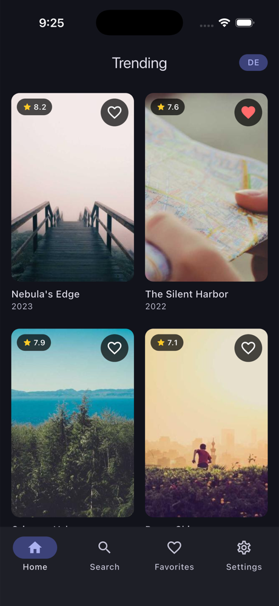
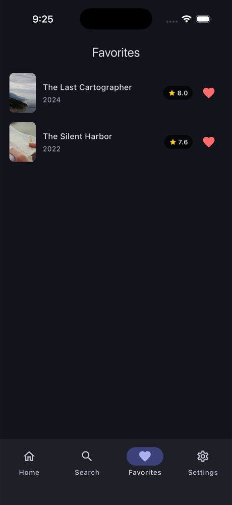

# Screenshots

Captured on an **iPhone 17 Pro simulator** (iOS, debug build) on 2026-10-09, then downscaled to 1000 px tall. The data comes from the bundled fake catalog; the posters are seeded placeholder photos from picsum.photos.

## Light

| Home | Search | Details |
|:---:|:---:|:---:|
|  |  |  |

## Dark

| Home | Favorites | Settings |
|:---:|:---:|:---:|
|  |  |  |

## What to look for

- **Dark mode** is applied app-wide by the `SettingsCubit` above `MaterialApp.router`, and survives a restart. The saved choice is read synchronously before the first frame, so there is no light flash.
- **The content-language badge** (`EN` → `DE`) on Home follows the Settings dropdown live.
- **Details status bar:** the icons are light over the backdrop, then return to the theme default once the header collapses.
- **Hearts stay in sync:** the movie favorited on Home also appears in Favorites (newest first), and as "In favorites" on its Details screen.

## Retaking them

```bash
fvm flutter build ios --simulator --debug
xcrun simctl install booted build/ios/iphonesimulator/Runner.app
xcrun simctl launch booted co.bitfuse.flutter.movieExplorer
xcrun simctl io booted screenshot docs/screenshots/<name>.png
sips -Z 1000 docs/screenshots/<name>.png   # downscale (macOS)
```
